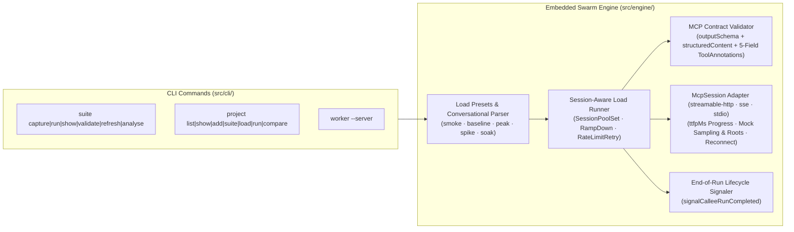

# `@zotoio/botz-mcp-swarm-cli` — Architecture, Protocol Engine & Release Guide

**Version:** `0.13.0`  
**Binary:** `botz-mcp-swarm` / `swarm` (invoked via host as `botz mcp-swarm [args]`)

## 1. Engine & CLI Architecture

## 2. Full 7-Stage MCP Specification Support

1. **Stage 1 (`outputSchema` & `structuredContent`)**: Validates `result.structuredContent` against `tool.outputSchema` via AJV JSON Schema validation (`contract.ts`).
2. **Stage 2 (5-Field `ToolAnnotations`)**: Preserves `title`, `readOnlyHint`, `destructiveHint`, `idempotentHint`, and `openWorldHint` during introspection (`suite-introspect.ts`).
3. **Stage 3 (`prompts/list` & `prompts/get`)**: Introspects and executes parameterized MCP prompt workflows.
4. **Stage 4 (`notifications/progress` & `ttfpMs`)**: Tracks `progressEventsCount`, `lastProgressMessage`, and `ttfpMs` with `resetTimeoutOnProgress: true`.
5. **Stage 5 (`completion/complete`)**: Exercises `ref/prompt` and `ref/resource` autocomplete endpoints when `capabilities.completions` is advertised.
6. **Stage 6 (`sampling/createMessage` & `roots/list`)**: Declares client `sampling` and `roots` capabilities and responds deterministically (`swarm-deterministic-sampler-v1` and `file:///workspace/swarm-sandbox`).
7. **Stage 7 (Resumability & End-of-Run Teardown)**: Automatically reconnects dropped Streamable HTTP sessions (`isSessionLostError`) and sends `signalCalleeRunCompleted` (`notifications/swarm/run_completed`, `swarm_run_completed`, and `POST /api/swarm/run-completed`) at run completion.

- **Runner HTTP Identification**: Outbound HTTP/SSE runner requests identify with `User-Agent: botz-mcp-swarm/<version> (mcp-tester)` and `X-Swarm-Run-Id: <runId>`.
